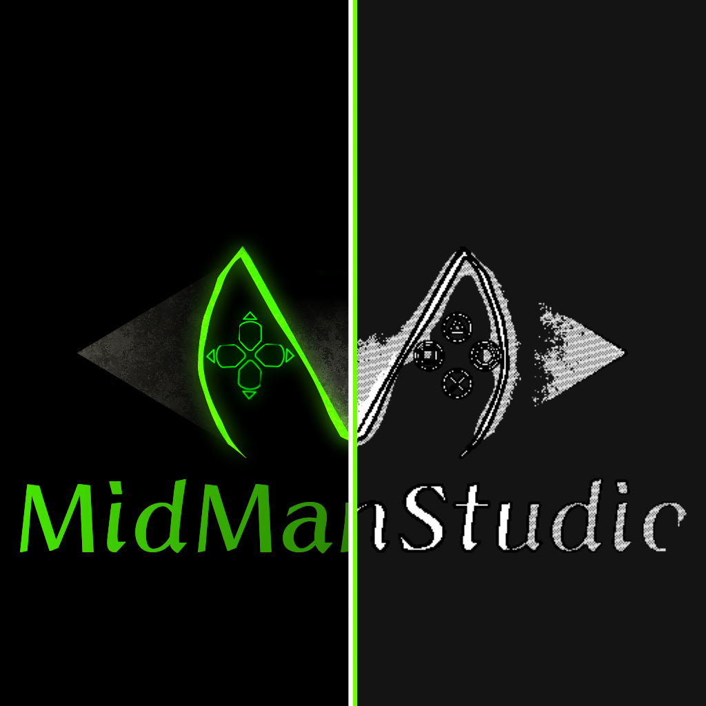

<p align="center">
  
</p>

# MidManStudio

The studio site for **MidManStudio** — Unity packages, the Rust-powered tech underneath them, and the projects built on top. Live at [midmanstudio.pages.dev](https://midmanstudio.pages.dev).

SvelteKit 2 + Svelte 5 (TypeScript), deployed to Cloudflare Pages.

## Develop

```bash
npm install
npm run dev       # local dev server
npm run check     # svelte-check + type check
npm run build     # production build -> .svelte-kit/cloudflare
npm run preview   # serve the production build locally
```

## Where the content lives

Most updates are data edits — no component changes needed.

| File | What it drives |
| --- | --- |
| `src/lib/data/packages.ts` | Unity package cards (MDIX Studio, utilities, audio, netcode, patterns, projectile system). Only cards with a `media` field get a screenshot / GIF slot. MDIX Studio's source lives in the DixScript-Rust repo; the rest are in MidManStudio_Unity |
| `src/lib/data/ecosystem.ts` | "Core Tech" cards (DixScript, mid-math, MSX, projectile_core) |
| `src/lib/data/projects.ts` | Shipped projects |
| `src/lib/data/media.ts` | Showcase gallery (images, GIFs, clips) |
| `src/lib/components/ContactFooter.svelte` | Contact section: email, Telegram, Discord and GitHub links (`email` and `links` at the top of the file) |

SIMD is deliberately attributed to **mid-math only** (the `mid-math` card in `ecosystem.ts`) — keep it out of the other cards.

## Adding showcase media

Everything is declared in `src/lib/data/media.ts`; files go under `static/media/`.

- **Image or GIF** — drop the file in `static/media/images/<folder>/`, then add an entry with `src: '/media/images/<folder>/<file>'`. A `.gif` is handled exactly like a `.png`. Set `width`/`height` (px) and a descriptive `alt`.
- **Video** — drop the file in `static/media/videos/`, then add an entry with `type: 'video'`, `src: '/media/videos/<file>.mp4'` and an optional `poster`.
- An entry with **no `src`** renders as a "coming soon" slot — fill it in later by adding the `src`.

Current folders: `game/` (Projectile System test scene), `mdix-studio/` (the Unity editor tool), `mdix-lsp/` (DixScript in VS Code).

## Games

The **Play** section of the page (`src/lib/components/PlayGame.svelte`, nav link `#play`) shows Death Roll as click-to-play: the game loads in an iframe only after the visitor presses Play, with Full screen, Open full page and Stop buttons. If `/play/death-roll/` is not published yet (a 404), the section shows a "Web build coming soon" poster instead, and it switches to the playable version on its own once the build is committed, with no site change needed.

`game/death-roll/` is Death Roll, a one-thumb downhill game written in C with raylib and built to WebAssembly (its own README has the details). It lives in this repo but outside `src/`, so it never touches the SvelteKit build. To publish a new build: `sh game/death-roll/build-web.sh` (needs emscripten and raylib's web build), then commit `static/play/death-roll/`. The site serves it at `/play/death-roll/`.

## Brand assets

- `static/brand/logo-wordmark.png` — full wordmark (README header)
- `static/brand/logo-mark.png` — cube icon used in the nav and footer
- `static/brand/og-image.png` — 1200×630 social card (referenced by `og:image` in `src/app.html`)
- `static/favicon.png` and `static/apple-touch-icon.png` — tab and home-screen icons, both made from the cube icon

## Deploy

Pushing to `main` runs `.github/workflows/deploy.yml`, which builds the site and publishes it to the Cloudflare Pages project `midmanstudio`. The workflow needs the repository secrets `CLOUDFLARE_API_TOKEN` and `CLOUDFLARE_ACCOUNT_ID`.

## Scaffold / replacements

This repo uses [mdix-scaffold](https://github.com/Mid-D-Man/mdix-scaffold). Batches of changed files are applied by committing a `.tar.gz` next to `.mdix/replacements/replacements.mdix` and running the **Apply replacements** workflow (`.github/workflows/run-replacements.yml`).

## License

Proprietary — all rights reserved. See [LICENSE](LICENSE).
